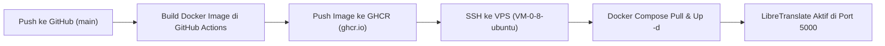

# Panduan Deployment & CI/CD LibreTranslate (Fork)

Dokumentasi ini menjelaskan konfigurasi otomatisasi CI/CD, pembatasan resource server, dan cara sinkronisasi dengan upstream resmi tanpa bentrok (*merge conflict*).

---

## 1. Prinsip Isolasi Kode (Zero-Conflict Upstream)
Seluruh kode inti LibreTranslate bawaan **tidak dimodifikasi sama sekali**. Penyesuaian konfigurasi dilakukan pada file-file independen:
- `docker-compose.deploy.yml` — Konfigurasi container produksi, port, batas memori & CPU.
- `.github/workflows/cicd-vps.yml` — Pipeline GitHub Actions untuk build image ke GHCR dan deploy otomatis ke VPS.
- `.env.deploy.example` — Template environment variable.

Dengan struktur ini, kapan pun Anda ingin memperbarui kode dari repositori resmi LibreTranslate, Anda cukup menjalankan:
```bash
git fetch upstream
git merge upstream/main
git push origin main
```
Proses *merge* akan berjalan bersih tanpa ada konflik kode.

---

## 2. Pembatasan Resource & Model Bahasa (ID & EN Saja)
Di file [`docker-compose.deploy.yml`](docker-compose.deploy.yml), pembatasan telah diterapkan secara ketat:

1. **Hanya Bahasa Indonesia & Inggris:**
   - `LT_LOAD_ONLY=id,en`
   - Hanya mengunduh dan memuat model bahasa Indonesia dan Inggris ke memori (menghemat ~85% penggunaan RAM dan bandwidth dibanding memuat seluruh 30+ bahasa).
2. **Batas Resource Container (Safety Cap):**
   - `memory: 1200M` (Maksimal 1.2 GB RAM agar tidak memicu OOM killer di VPS Anda).
   - `cpus: '1.0'` (Maksimal 1 core CPU agar proses web Laravel & PostgreSQL tetap lancar).
3. **Persistensi Model:**
   - Volume `libretranslate_models` menyimpan model bahasa secara permanen di VPS, sehingga saat container di-*restart*, model tidak perlu diunduh ulang.
4. **Safety Quota & Threads:**
   - `LT_THREADS=2` (Mencegah lonjakan thread berlebih).
   - `LT_CHAR_LIMIT=5000` & `LT_REQ_LIMIT=120`.

---

## 3. Alur Otomatisasi CI/CD (GitHub Actions)
Pipeline pada file [`.github/workflows/cicd-vps.yml`](.github/workflows/cicd-vps.yml) bekerja secara otomatis saat Anda melakukan `git push` ke branch `main`:



### Keuntungan Build di GitHub Actions:
Proses kompilasi Python, PyTorch, dan dependency yang berat dikerjakan sepenuhnya di server gratis GitHub Actions (yang memiliki 16 GB RAM). Server VPS Anda hanya perlu mengunduh image hasil jadi (*pull & run*), sehingga CPU dan RAM VPS tidak terbebani saat proses build!

---

## 4. Kebutuhan Secret & Variable GitHub
Pastikan repository GitHub fork Anda (`khensin166/LibreTranslate`) memiliki Secret / Variable berikut di menu **Settings ➔ Secrets and variables ➔ Actions** (sama persis dengan yang sudah Anda gunakan di Muter-Muter App):

| Tipe | Nama | Keterangan |
| :--- | :--- | :--- |
| **Secret / Var** | `VPS_IP` | Alamat IP Publik VPS Anda |
| **Secret / Var** | `VPS_USER` | Username SSH VPS (contoh: `ubuntu`) |
| **Secret** | `VPS_SSH_KEY` | Private SSH Key untuk login ke VPS |

*(Catatan: Token GHCR ditangani otomatis oleh built-in `${{ secrets.GITHUB_TOKEN }}`, tidak perlu setup token manual).*

---

## 5. Menghubungkan Muter-Muter App ke LibreTranslate
Setelah container aktif di VPS pada port `5000`, aplikasi Muter-Muter App dapat memanggil endpoint translasi lokal:

- **Endpoint:** `http://127.0.0.1:5000/translate` (atau nama container `http://libretranslate:5000/translate` jika berada dalam Docker network yang sama).
- **Format Request POST:**
  ```json
  {
    "q": "Danau Toba sangat indah dan mempesona",
    "source": "id",
    "target": "en",
    "format": "text"
  }
  ```
- **Format Response:**
  ```json
  {
    "translatedText": "Lake Toba is very beautiful and enchanting"
  }
  ```

